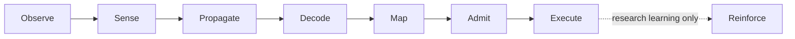

<p align="center">
  
</p>

<h1 align="center">Coinfly</h1>

<p align="center">
  Paper-trading research desktop that drives the full MaleCNS fruit-fly connectome with crypto market data.
</p>

<p align="center">
  <a href="https://github.com/devsolux/coinfly/actions/workflows/ci.yml"></a>
  <a href="LICENSE"></a>
  
  
</p>

> [!WARNING]
> **Experimental research software.** Coinfly is shared as-is for research and
> education. There is no guarantee that it works, is stable or will be updated,
> and no claim that it trades profitably. Paper execution is the default and live
> trading is closed. This is not financial advice. Use it at your own risk.

## Overview

Coinfly feeds crypto order-book data into the complete retained **MaleCNS v1.0**
male fruit-fly connectome (166,700 neurons, 25,582,938 edges, no pruning) and lets
identified descending neurons propose paper trades. A separate worker process owns
the autonomous loop, exact accounting, risk limits and isolated paper execution;
the desktop app only sends commands and shows status.

## Highlights

- **The whole graph, no shortcuts.** A native C++ spiking kernel runs every retained
  neuron. A HOLD is never replaced by a scripted trade, and no LLM policy or hidden
  profit rule selects actions.
- **Exact, durable accounting.** Decimal quantities, order intent persisted before
  dispatch, and a fresh SQLite ledger pinned by schema digests.
- **Fail-closed execution.** Stale data, sequence gaps and silent feeds block
  decisions. Unknown order outcomes halt execution until reconciliation and are
  never blindly retried.
- **Risk can veto, never trade.** The risk guard may reject an order; it never
  chooses a different one.
- **Labeled market data.** Coinbase public REST/WebSocket (no credentials), recorded
  replays or synthetic fixtures, each labeled end to end.

## How it works



| Stage | What happens |
| --- | --- |
| Observe | Read an order book from a labeled source. |
| Sense | Four fixed features become an 8-bit RGB frame delivered through a photoreceptor proxy (an engineered input, not a market model). |
| Propagate | The native kernel runs the whole graph. |
| Decode | A fixed decoder reads the DNp20 (left/right) and DNpe017 descending neurons as BUY, SELL or HOLD. |
| Map | A fixed mapping moves only the chosen instrument's target weight, by at most the configured step. |
| Admit | An exact planner, turnover guard and risk actor check capital, exposure, drawdown and loss limits. |
| Execute | The intent is stored, filled in the paper book and reconciled. |
| Reinforce | *Research learning only:* paper profit/loss stimulates two identified dopamine cells (PAM11, PPL101), and a bounded three-factor rule adjusts existing KC→MBON synapses. |

Reinforcement is an engineered input. It does not model pain, pleasure or
consciousness, and profitable learning is unverified. See the
[autonomous lifecycle](docs/autonomous-lifecycle.md) for the full loop.

## Project status

| Area | Available | Not yet supported or qualified |
| --- | --- | --- |
| Execution | Paper (SANDBOX) spot and synthetic perpetuals with an exact local ledger | Real-money trading; live mode is closed by default |
| Market data | Coinbase public REST and WebSocket level2, JSON-lines replay, synthetic fixtures | Other exchanges |
| Controllers | Full-graph baseline inference, frozen checkpoints, single-slot paper research learning | Any validated trading result |
| Platforms | macOS ARM64, Windows AMD64 and Linux AMD64 from source | Native desktop smoke tests and native runs on every target |
| Credentials | macOS Keychain, Windows Credential Manager, Linux Secret Service; no plaintext fallback | Linux native execution-vault bridge |
| Storage | Fresh 1.0.0 SQLite ledger pinned by schema digests | Migration or import of older or modified ledgers |

Details: [implementation status](docs/implementation-status.md),
[venue capabilities](docs/venues/capability-matrix.md) and the
[latest validation evidence](docs/evidence-matrix.md).

## Getting started

**Requirements:** Python ≥3.11 linked to SQLite ≥3.51.3 with Tk,
[uv](https://docs.astral.sh/uv/), and CMake with a C++ toolchain for the native kernel.

```sh
python dev.py setup     # create the locked environment
python dev.py prepare   # download and verify the MaleCNS v1.0 dataset (about 1.1 GB on first use)
python dev.py kernel    # build the native spiking kernel
python dev.py run       # start the desktop app
```

On Windows use `py dev.py …` or `./dev.ps1 …`; on macOS `./dev.sh …` is
equivalent. In **Overview**, configure the `malecns-autonomous` strategy (capital,
slot limit, feed and controller) and enable automation. The
[paper startup runbook](docs/runbooks/paper-startup.md) walks through each step.
Paper mode needs no exchange credentials, and application data lives under
`~/.devsolux/coinfly`.

## Development

```sh
python dev.py check     # lint, strict type checks and the full test suite
python dev.py test      # tests only; pytest arguments pass through
python dev.py test-ui   # native desktop smoke tests (needs a desktop session)
python dev.py doctor    # environment and production-readiness diagnostics
```

CI runs lint, type checks, tests, package verification and a native compile on
macOS, Windows and Linux for every pull request and push to `main`. Project rules
for contributors and agents are in [AGENTS.md](AGENTS.md).

macOS release builds (`./dev.sh build-unsigned`, `./dev.sh build`, optionally with
`--preflight`) stay closed until genuine production prerequisites are supplied. See
[desktop packaging](packaging/README.md) and
[macOS production builds](docs/devsh-production-builds.md).

## Documentation

The [documentation index](docs/README.md) covers operation, runbooks, venues and
architecture. Start with:

- [Paper startup without credentials](docs/runbooks/paper-startup.md)
- [Full-graph provenance and dataset bootstrap](docs/malecns-bootstrap.md)
- [Experimental training and evaluation](docs/malecns-training.md)
- [Safety invariants and supporting tests](docs/requirements/invariants.md)

## License

Coinfly's source code is released under the [MIT License](LICENSE). The MaleCNS
v1.0 connectome data is not bundled: it is downloaded from the upstream
[FlyEM/Janelia release](https://male-cns.janelia.org/download/) on first use and
remains subject to its publisher's terms.
